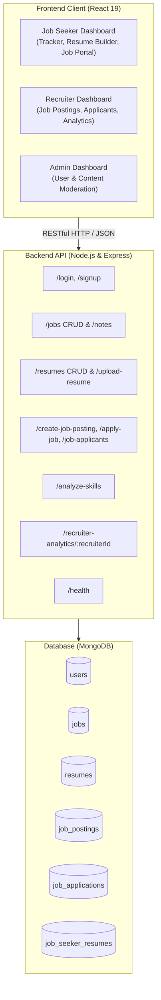

# 🚀 Job Tracking & Placement Management System

[](https://github.com/Karthikeya31972/Job-tracker-project/actions/workflows/deploy.yml)
[](https://react.dev/)
[](https://nodejs.org/)
[](https://expressjs.com/)
[](https://www.mongodb.com/)
[](https://opensource.org/licenses/MIT)

> **A comprehensive full-stack platform bridging Job Seekers, Recruiters, and Administrators with application lifecycle tracking, structured resume building, intelligent skill extraction, and analytics dashboards.**

---

## 🌐 Live Demo & Deployment

- 🔗 **GitHub Pages Frontend:** [https://karthikeya31972.github.io/Job-tracker-project/](https://karthikeya31972.github.io/Job-tracker-project/)
- 🔗 **Alternative Live Link:** [https://job-tracker-project-two.vercel.app/](https://job-tracker-project-two.vercel.app/)
- 📄 **Project Documentation:** [PROJECT_DOCUMENTATION.md](./PROJECT_DOCUMENTATION.md) | [PDF Report](./Project_Documentation.pdf)

---

## 📖 Table of Contents

- [Overview](#-overview)
- [Key Features](#-key-features)
- [System Architecture](#-system-architecture)
- [Core Modules Breakdown](#-core-modules-breakdown)
- [Technology Stack](#-technology-stack)
- [Database Schema & Collections](#-database-schema--collections)
- [API Reference](#-api-reference)
- [Getting Started](#-getting-started)
  - [Prerequisites](#prerequisites)
  - [Installation & Setup](#installation--setup)
  - [Environment Variables](#environment-variables)
  - [Running the Application](#running-the-application)
- [Deployment Guide](#-deployment-guide)
  - [GitHub Pages (CI/CD)](#1-github-pages-automated-via-github-actions)
  - [Vercel & Render](#2-vercel--render)
- [Repository Artifacts & Academic Assets](#-repository-artifacts--academic-assets)
- [Author & Acknowledgements](#-author--acknowledgements)

---

## 🌟 Overview

The **Job Tracking System** solves the fragmentation and disorganization of modern job hunts and recruitment workflows. Instead of maintaining disconnected spreadsheets, sticky notes, and disparate email chains, this platform centralizes:

1. **Job Seekers:** Personal application tracking (Applied, Interview, Offer, Rejected), deadline calendars, resume creation with live preview, and direct job applications.
2. **Recruiters:** Post vacancies, review candidate submissions with attached resumes/cover letters, make hiring decisions, and track pipeline analytics with graphical charts.
3. **Administrators:** Full system governance, candidate & recruiter account moderation, posting oversight, and cascade database cleanup.

---

## ✨ Key Features

- 🎯 **Role-Based Workflows:** Distinct, customized dashboards for Job Seekers (`client`/`job_seeker`), Recruiters (`recruiter`), and Administrators (`admin`).
- 📊 **Application Lifecycle Tracker:** Kanban-style and list views tracking applications across states (`Applied`, `Interviewing`, `Offer`, `Rejected`, `Withdrawn`) with custom interview notes and URLs.
- 📅 **Deadline & Follow-up Calendar:** Visual deadline monitor ensuring applicants never miss submission cutoffs or follow-up milestones.
- 📝 **Structured 6-Section Resume Builder:** Build, edit, and store multiple professional resume versions with personal info, summaries, experience, education, tags for 40+ skills, and portfolio projects.
- 🧠 **Smart Skill Extraction:** Keyword-based NLP engine analyzing job descriptions and resumes to extract technical stacks, frameworks, tools, and soft skills automatically.
- 📈 **Recruiter Analytics Dashboard:** Real-time data visualization via Chart.js and Recharts displaying candidate volume, acceptance/rejection ratios, and job conversion metrics.
- 🌓 **Dynamic Dark Mode:** Clean, responsive UI with native dark/light theme switching across all views.
- 🛡️ **Resilient Backend:** Automatic connection fallback between MongoDB Atlas and local MongoDB (`127.0.0.1:27017`), complete with server health monitoring (`/health`).

---

## 🏗️ System Architecture



---

## 📦 Core Modules Breakdown

| # | Module Name | Primary Role | Key Capabilities |
|---|---|---|---|
| **1** | **Authentication & RBAC** | All Roles | Multi-role registration (`client`, `recruiter`, `admin`), session persistence via `localStorage`, role-gated routing. |
| **2** | **Job Tracking Module** | Job Seeker | Full CRUD application monitoring, interview date tracking, status workflows, notes, follow-up flags. |
| **3** | **Resume Builder Module** | Job Seeker | 6-section builder (Personal Info, Summary, Work History, Education, Skills, Projects) with MongoDB persistence. |
| **4** | **Two-Sided Job Portal** | Seeker & Recruiter | Recruiter posting creation, public job listings, application submissions with resume & cover letter attachments. |
| **5** | **Recruiter Analytics** | Recruiter | Conversion metrics, application volume, acceptance vs rejection charts using Chart.js & Recharts. |
| **6** | **Skill Analysis Module** | System Engine | Automatic keyword extraction matching 40+ programming languages, frameworks, cloud tools, and contextual soft skills. |
| **7** | **Admin Moderation Module** | Administrator | Platform health oversight, user account management, job vacancy moderation, cascade deletion. |

---

## 💻 Technology Stack

### Frontend
- **Framework:** React 19.2
- **Routing:** React Router DOM 7.13
- **HTTP Client:** Axios 1.13 (Centralized via `services/api.js`)
- **Data Visualization:** Chart.js 4.5, React-Chartjs-2, Recharts 3.8
- **Styling:** Modular Vanilla CSS, CSS Grid/Flexbox, Dark Mode Palette

### Backend
- **Runtime:** Node.js (v18+)
- **Framework:** Express.js 4.22
- **Database Driver:** MongoDB Driver 6.21
- **Utilities:** CORS, Dotenv, Docx (Word report compilation)
- **Architecture:** Modular REST API with fallback database connection strategy

### Database
- **Engine:** MongoDB (Local instance `mongodb://127.0.0.1:27017` or MongoDB Atlas Cloud)
- **Collections:** 6 indexed collections (`users`, `jobs`, `resumes`, `job_postings`, `job_applications`, `job_seeker_resumes`)

### CI/CD & Deployment
- **GitHub Actions:** Automated build & deployment workflow (`.github/workflows/deploy.yml`)
- **Hosting:** GitHub Pages (Frontend), Vercel (Frontend Alternative), Render (Backend API)

---

## 🗄️ Database Schema & Collections

| Collection | Key Fields | Indexed Fields |
|---|---|---|
| `users` | `username`, `password`, `role` (`client` \| `recruiter` \| `admin`), `created_at` | `username` (unique) |
| `jobs` | `user_id`, `company`, `role`, `status`, `deadline`, `date_applied`, `followup`, `notes`, `url` | `user_id` |
| `resumes` | `user_id`, `name`, `personalInfo`, `summary`, `experience`, `education`, `skills`, `projects` | `user_id` |
| `job_postings` | `recruiter_id`, `position`, `company`, `description`, `requirements`, `created_at` | `recruiter_id` |
| `job_applications` | `user_id`, `job_id`, `recruiter_id`, `resume_attachment`, `cover_page_attachment`, `status` | `user_id`, `job_id` |
| `job_seeker_resumes` | `user_id`, `name`, `file_content` (Base64), `created_at` | `user_id` |

---

## 🔌 API Reference

Base URL: `http://localhost:5000`

### System & Health
| Method | Endpoint | Description |
|---|---|---|
| `GET` | `/health` | Server status and timestamp check |

### Authentication
| Method | Endpoint | Request Body | Description |
|---|---|---|---|
| `POST` | `/signup` | `{ username, password, role }` | Register new user account |
| `POST` | `/login` | `{ username, password }` | Authenticate user credentials |

### Job Application Tracking (Personal)
| Method | Endpoint | Description |
|---|---|---|
| `GET` | `/jobs?user_id=<id>&role=<role>` | Retrieve applications for user |
| `POST` | `/jobs` | Add new job application entry |
| `PUT` | `/jobs/:jobId` | Update job status, deadline, or notes |
| `DELETE` | `/jobs/:jobId?user_id=<id>` | Delete tracked job entry |
| `GET` | `/jobs/:jobId/notes` | Get specific interview/application notes |
| `POST` | `/jobs/:jobId/notes` | Update interview/application notes |

### Resume Builder
| Method | Endpoint | Description |
|---|---|---|
| `GET` | `/resumes?user_id=<id>` | List structured resumes for user |
| `POST` | `/resumes` | Create structured resume |
| `PUT` | `/resumes/:resumeId` | Update existing structured resume |
| `DELETE` | `/resumes/:resumeId?user_id=<id>` | Delete resume |
| `POST` | `/upload-resume` | Upload standalone document (Base64) |
| `GET` | `/resumes/:userId` | Get standalone uploaded documents |

### Recruitment Portal
| Method | Endpoint | Description |
|---|---|---|
| `POST` | `/create-job-posting` | Recruiter publishes new job opportunity |
| `GET` | `/job-postings` | Get all active public job vacancies |
| `GET` | `/recruiter-jobs/:recruiterId` | Get vacancies created by specific recruiter |
| `DELETE` | `/job-postings/:jobId` | Delete job vacancy and cascade applications |
| `POST` | `/apply-job` | Seeker submits application with attachments |
| `GET` | `/job-applications/:userId` | Get applications submitted by seeker |
| `GET` | `/job-applicants/:jobId` | Get candidates who applied for job posting |
| `PATCH` | `/job-applications/:appId/status` | Recruiter marks status (`accepted` / `rejected`) |
| `GET` | `/recruiter-analytics/:recruiterId` | Aggregate analytics for recruiter's postings |

### Intelligence & Admin
| Method | Endpoint | Description |
|---|---|---|
| `POST` | `/analyze-skills` | Extract skill keywords from text description |
| `GET` | `/admin/jobs?role=admin` | View all platform job applications |
| `GET` | `/admin/clients?role=admin` | List registered client accounts |
| `DELETE` | `/admin/clients/:id?role=admin` | Remove user and cascade delete records |
| `POST` | `/reset-db` | Reset and clear database collections |

---

## 🚀 Getting Started

### Prerequisites
- [Node.js](https://nodejs.org/) (v18.x or later)
- [npm](https://www.npmjs.com/) (v9.x or later)
- [MongoDB](https://www.mongodb.com/) running locally or a MongoDB Atlas connection string

### Installation & Setup

1. **Clone the repository:**
   ```bash
   git clone https://github.com/Karthikeya31972/Job-tracker-project.git
   cd Job-tracker-project
   ```

2. **Install all dependencies across root, backend, and frontend:**
   ```bash
   npm run install-all
   ```

### Environment Variables

#### Backend (`backend/.env`)
```env
MONGO_URI=mongodb://127.0.0.1:27017
PORT=5000
DB_NAME=jobtracker
```

#### Frontend (`frontend/.env`)
```env
REACT_APP_API_URL=http://127.0.0.1:5000
```

### Running the Application

- **Run both backend and frontend concurrently (Recommended):**
  ```bash
  npm start
  ```
- **Or run services individually:**
  ```bash
  # Terminal 1: Start Backend (http://localhost:5000)
  npm run backend

  # Terminal 2: Start Frontend (http://localhost:3000)
  npm run frontend
  ```

---

## 🚢 Deployment Guide

### 1. GitHub Pages (Automated via GitHub Actions)
This repository includes a pre-configured CI/CD workflow [`.github/workflows/deploy.yml`](./.github/workflows/deploy.yml).

**How it works:**
1. Whenever changes are pushed to `main`, GitHub Actions automatically builds the production React application.
2. It generates `404.html` to support client-side routing on page refresh.
3. It deploys the build artifacts to the `gh-pages` branch.
4. **To enable GitHub Pages in your repo:**
   - Go to your repository **Settings** > **Pages**.
   - Under **Build and deployment**, set **Source** to **Deploy from a branch**.
   - Select branch **`gh-pages`** and folder **`/ (root)`**, then click **Save**.

### 2. Vercel & Render
- **Frontend (Vercel):** Connect repository, set root directory to `frontend`, build command `npm run build`, output directory `build`.
- **Backend (Render):** Connect repository, build command `cd backend && npm install`, start command `cd backend && npm start`. Set `MONGO_URI` to your MongoDB Atlas cluster.

---

## 📚 Repository Artifacts & Academic Assets

This repository also contains complete academic deliverables and documentation generation pipelines:

- 📄 [PROJECT_DOCUMENTATION.md](./PROJECT_DOCUMENTATION.md): 2,500+ line technical software report.
- 📄 [PROJECT_DOCUMENTATION_FORMAL.md](./PROJECT_DOCUMENTATION_FORMAL.md): Formal institutional project report.
- 📄 [core_modules_explanation.md](./core_modules_explanation.md): Architectural deep-dive on the 7 core modules.
- 📊 [PRESENTATION_SLIDES.md](./PRESENTATION_SLIDES.md): Full presentation slide deck outline.
- 🎓 [Cassandra_Hive_Exam_Notes.md](./Cassandra_Hive_Exam_Notes.md): Comprehensive 1,800+ line study guide on NoSQL & Big Data architectures.
- 🐍 **Document Generators (`convert_*.py`, `markdown_to_pptx*.py`):** Python automation scripts converting markdown documentation into styled Microsoft PowerPoint (.pptx) and PDF files.
- 📄 **Word Report Generator (`backend/kindex.js`):** Script compiling the academic report `Job_Tracking_System_Report.docx`.

---

## 👨‍💻 Author & Acknowledgements

- **Developed By:** **Are Karthikeya** ([@Karthikeya31972](https://github.com/Karthikeya31972))
- **Project Title:** Job Tracking System (Mini Project)
- **License:** [MIT](./LICENSE)
